# 🏥 Middleware Orientado a Eventos para Interoperabilidade em Saúde (CDC → HL7 FHIR R4)

> **Repositório Vitrine (Arquitetura, Padrões & Benchmark)** — Baseado no trabalho de pesquisa *"Migração de Arquitetura de Integração em Saúde: Substituição de ETL em Lote por Middleware Orientado a Eventos com o Padrão HL7 FHIR"* (UNEMAT, 2026), alinhado às diretrizes da **Rede Nacional de Dados em Saúde (RNDS — Portaria MS nº 1.434/2020)**.
>
> *(Nota: O código-fonte completo encontra-se em repositório privado durante a etapa acadêmica, disponível para demonstração técnica ao vivo em entrevistas.)*

---

## 🎯 Problema & Motivação

Integrações legadas baseadas em **ETL em lote (batch)** impõem gargalos críticos em operadoras de saúde:
- **Defasagem temporal (D+1):** dados assistenciais e cadastrais só sincronizam em janelas noturnas;
- **Concorrência e locks na origem:** varreduras extensivas (*Full Table Scans*), *views* e *stored procedures* disputam CPU/I/O com o sistema transacional;
- **Acoplamento estrutural:** ausência de um modelo semântico canônico entre sistemas heterogêneos.

---

## 🏗️ Arquitetura e Padrões Aplicados

O middleware foi projetado sob o paradigma da **Design Science Research (DSR)** combinando **Arquitetura Orientada a Eventos (EDA)**, **Padrão Estrangulador (*Strangler Fig*)** para migração incremental, **Arquitetura Hexagonal** e **Camada Anticorrupção (ACL)**:

```mermaid
flowchart LR
    PG[(PostgreSQL 15\nwal_level=logical)] -->|WAL / pgoutput\nZero Locks| DEB[Debezium Server 2.4\nCDC Connector]
    DEB -->|Eventos 1:1| RMQ[[RabbitMQ 3\nTopic Exchanges + DLQ]]
    RMQ --> PAT[patient-fhir-service\nHexagonal · Porta 8081]
    RMQ --> OBS[observation-fhir-service\nLOINC · Porta 8082]
    PAT -->|Enriquecimento Pontual O&#40;1&#41;| CAF[(Caffeine Cache v3.1\n& tb_enrichment_rules)]
    PAT -->|Bundle Patient + Coverage| BUS[[fhir.protocolo.gerado\nFan-Out]]
    OBS -->|Observation R4| BUS
    BUS --> WRK[protocol-worker-service\nACL + UPSERT · Porta 8085]
    WRK --> DW[(Banco Analítico\nRAW.TB_*)]
    GW[gateway-service\nSpring Cloud Gateway · 8080] --> PAT
```

### Destaques de Engenharia
- **Processamento Schemaless (`patient-fhir-service`):** manipulação dinâmica de eventos (`Map<String, Object>`) com extração via **Jayway JsonPath v2.9.0** externalizada em configuração (12-Factor App).
- **Motor de Enriquecimento Dinâmico (*Control Plane vs. Data Plane*):** regras SQL armazenadas em `middleware.tb_enrichment_rules` e mantidas em memória com **Caffeine Cache** (`@Cacheable`), buscando dados satélites pontualmente por chave primária sem varreduras de tabela.
- **Multi-tenancy Dinâmico (`TenantResolver`):** resolução do inquilino diretamente dos cabeçalhos AMQP e payload CDC sem recompilação.
- **Sincronização de Expurgo / *Soft-Delete*:** mutações de exclusão física na origem (`op = 'd'`) são capturadas via *before image* do WAL, convertidas em cancelamento de vigência no recurso FHIR `Coverage` e persistidas como inativação lógica rastreável (`ATIVO = false`).
- **Tolerância a Falhas & Idempotência (`protocol-worker-service`):** Camada Anticorrupção (ACL) com *flattening* de Bundles FHIR, persistência idempotente (**UPSERT** via Spring Data JPA) e isolamento de mensagens corrompidas em **Dead Letter Queues (DLQ)** (`patient-fhir-dlq`, `observation-fhir-dlq`) com `default-requeue-rejected: false`.
- **Domínio Clínico (`observation-fhir-service`):** normalização de resultados de exames laboratoriais para a ontologia internacional **LOINC** e emissão de recursos **HL7 FHIR `Observation`**.

---

## ⚙️ Stack Tecnológica

- **Linguagem & Framework:** Java 17, Spring Boot 3.2, Spring Cloud Gateway, Spring Data JPA, Spring AMQP
- **Interoperabilidade:** HAPI FHIR R4 Core v6.10.0 (`Patient`, `Coverage`, `Observation`, `Bundle`), Ontologia LOINC
- **CDC & Mensageria:** Debezium Server 2.4 (`pgoutput`), RabbitMQ 3 (Topic Exchanges, DLQ, *prefetch* = 25, *concurrency* = 2–4)
- **Banco, Cache & Parse:** PostgreSQL 15 (`wal_level = logical`), Caffeine Cache v3.1, Jayway JsonPath v2.9.0
- **Infraestrutura & Baseline:** Docker Engine 24, Docker Compose, OpenAPI/Swagger, Pentaho Data Integration 9.5 (Baseline ETL)

---

## 📊 Resultados Experimentais

### 1. Carga Massiva: ETL Pentaho (Baseline) vs. Middleware CDC + FHIR (~50.000 registros)
| Métrica | ETL Pentaho (Baseline) | Middleware Proposto (CDC + FHIR) |
| :--- | :--- | :--- |
| **Volume Processado** | 50.014 registros | 50.000 registros |
| **Tempo Total** | 2m 54s (174 s) | 8m 55s (535,42 s) |
| **Vazão Média Sustentada** | 286 reg/s | 93 msg/s *(~200 mil ops SQL a ~2,6 ms/op)* |
| **Pico de Absorção** | – | **370 msg/s** |
| **Bloqueios na Origem (`pg_locks`)** | Não avaliado *(varredura em lote)* | **0 bloqueios observados** *(leitura assíncrona via WAL)* |
| **Defasagem Temporal (*Lag*)** | D+1 | **Contínua (~504 ms)** |
| **Padronização Semântica** | Proprietária / Rígida | **Canônica Internacional (HL7 FHIR R4)** |

### 2. Latência Ponta a Ponta (E2E) — 50 mutações consecutivas
| Métrica Estatística | Valor Obtido |
| :--- | :--- |
| **Iterações com Sucesso** | **50 / 50 (100%)** |
| **Eventos Perdidos ou Rejeitados** | **0** |
| **Latência Média ($\mu$)** | **504,26 ms** |
| **Latência Mínima / Máxima** | 328,00 ms / 683,00 ms |
| **Desvio Padrão ($\sigma$)** | 78,42 ms |
| **Percentil 95 ($p_{95}$)** | **612,00 ms** *(abaixo do limiar de 1s)* |

---

## 📫 Autor

**Salatiel Bonfim Gomes** — Desenvolvedor Full Stack Júnior (Java · Spring Boot · Angular)  
💼 [LinkedIn](https://www.linkedin.com/in/salatiel-bonfim/) · 📧 salatielbonfim236@gmail.com
